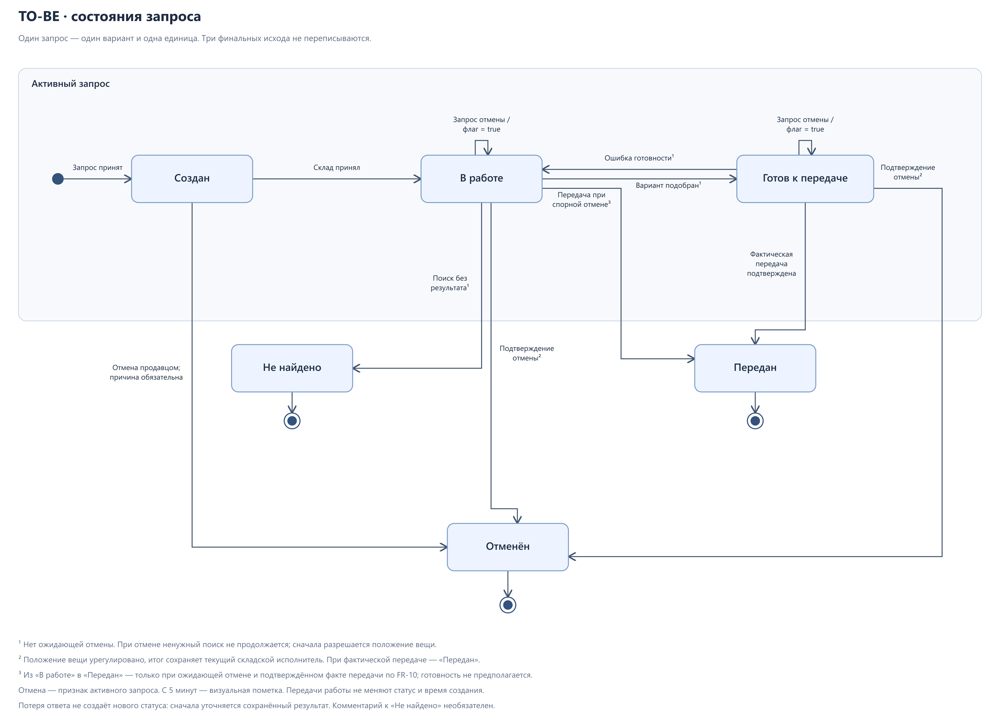

# Проектные решения и открытые вопросы

Решения относятся к целевому процессу StoreAssist. Здесь собраны их основания, модель состояний и вопросы для подготовки пилота. [Требования](02-REQUIREMENTS.md) задают поведение модуля, [сценарии](07-USE-CASES.md) — последовательности действий.

## Ключевые решения

| Решение | Почему | Подробнее |
| --- | --- | --- |
| Развивать один модуль запроса | Позволяет связать проблему, процесс и проверку в понятных границах | [D-01](#d-01) · [D-02](#d-02) |
| Сохранять фактическое подтверждение передачи складом | Готовность и смена продавца ещё не означают выдачу | [D-07](#d-07) · [D-29](#d-29) |
| Предупреждать о прошлом поиске без автоматического запрета | Одна неудачная попытка не доказывает отсутствие товара; актуальный ноль проверяется отдельно | [D-12](#d-12) · [D-21](#d-21) |
| Менять ответственного после принятия коллегой | Отказ или отсутствие ответа не должны оставлять работу без владельца | [D-13](#d-13) · [D-18](#d-18) |
| Отделить проверку расхождения от запроса выдачи | Проверка может продолжаться после завершения обслуживания; её результат не переписывает выдачу | [D-14](#d-14) · [D-25](#d-25) |
| Оставить исправление учёта существующей системе | Наблюдение сотрудника требует проверки и отдельного полномочия | [D-15](#d-15) · [D-30](#d-30) |
| Оформлять альтернативу новым связанным запросом | Сохраняются точный исходный вариант и история поиска | [D-16](#d-16) · [D-28](#d-28) |

## Полный реестр решений

| ID | Решение | Почему |
| --- | --- | --- |
| D-01 | Анализируется модуль запроса, а не всё приложение Inditex | Один сквозной процесс можно полноценно проверить |
| D-02 | Один магазин, вариант и единица на запрос | Избежать частичной выдачи и маршрутизации между магазинами в первом объёме |
| D-03 | Фокус на ожидании, ненайденном товаре и неактуальных запросах | Эти проблемы возникали в работе магазина |
| D-04 | Статусы проектируются только для TO-BE; названия и набор статусов исходного приложения в AS-IS не воспроизводятся | Исторические статусы не установлены. AS-IS описывает подтверждённые действия участников, очередь, отмену через iPod и подтверждение передачи на терминале, без переноса проектных статусов в исходный процесс |
| D-05 | Сохраняются iPod продавца и терминал на складе | В AS-IS очередь и отмена доступны в iPod; склад видит отмену и подтверждает передачу через терминал |
| D-06 | Резерв и коррекция остатков не реализуются внутри модуля | Они требуют отдельного процесса учёта и правил всех каналов |
| D-07 | Сохраняется подтверждение передачи сотрудником склада на терминале | Случаев ошибочного подтверждения передачи не отмечалось; дополнительное действие продавца не обосновано |
| D-08 | Начатая отмена требует разрешения исполнителем | Нужно учесть фактическое положение подобранной вещи |
| D-09 | Для оценки результата подготовлен план пилота | Базовые значения и результаты измерений пока отсутствуют |
| D-10 | Исход «Не найдено» передаётся с терминала в iPod | В AS-IS сотрудник склада выходил в зал и лично сообщал результат продавцу |
| D-11 | Сохраняется показ стеллажа и секции из существующей системы | Адрес хранения уже был доступен в AS-IS |
| D-12 | Предупреждение о прошлом поиске не блокирует запрос | Вещь могла быть найдена или перемещена; история не является достоверным остатком |
| D-13 | Передача поиска требует принятия новым исполнителем | Нельзя оставлять задачу без ответственного или назначать двух исполнителей |
| D-14 | Обращение на проверку имеет собственный жизненный цикл | Проверка может продолжаться после завершения выдачи или поиска |
| D-15 | Ошибка размещения исправляется после проверки в действующей системе | Наблюдение сотрудника не является автоматической учётной операцией |
| D-16 | Альтернатива создаёт отдельный связанный запрос | Нужны согласие покупателя, точный вариант и сохранение истории исходного поиска |
| D-17 | Текущее состояние запроса проверяется при принятии передачи поиска | Отмена или завершение не должны теряться при смене исполнителя |
| D-18 | Передача обслуживания отделена от передачи поиска | Продавец ведёт покупателя и все его запросы, а складской исполнитель выполняет конкретный поиск / выдачу |
| D-19 | Коллега принимает всё активное обслуживание с историей | Частичная смена продавца по запросам может разделить уведомления и ответственность |
| D-20 | Права и новые уведомления следуют текущему продавцу | Авторство старого запроса не даёт права менять его после принятой передачи; непросмотренные результаты доступны новому продавцу |
| D-21 | В TO-BE актуальный нулевой остаток запрещает запрос; неизвестные или устаревшие сведения требуют предупреждения и отдельного подтверждения продавца | Принято для обычного и альтернативного запроса; устаревший ноль не считается актуальным. См. [RULE-21](02-REQUIREMENTS.md#rule-21) и [FR-31](02-REQUIREMENTS.md#fr-31) |
| D-22 | Для первого пилота активный запрос визуально помечается с 5 минут от сохранённого времени создания | Пометка видна продавцу и руководителю, не меняет состояние или исполнителя. Это настройка контроля; целевые значения эффекта определяются после базового замера |
| D-23 | Для первого пилота задан срок предупреждения о прошлом «Не найдено» — 2 часа от сохранённого исхода по тому же магазину и точному варианту | Подтверждённое нахождение или проверка, снявшая проблему, прекращают предупреждение раньше. Срок не продлевается просмотром; новый исход начинает своё окно. Это настройка пилота, а не подтверждение отсутствия товара |
| D-24 | Перед каждой новой отправкой обновлять текущий остаток выбранного магазина и варианта из существующей системы | Успешное обновление определяет ветку наличия для этой попытки. При неудаче нужны предупреждение и подтверждение продавца; подтверждение продолжает ту же попытку. Это ожидаемое поведение TO-BE, не гарантия физического наличия |
| D-25 | Обращение о ненайденном товаре или неверном размещении ведёт и закрывает старший склада своего магазина | После принятия фиксируется конкретный ответственный. Учёт исправляет уполномоченный сотрудник в существующей системе; старший может совместить действия только при отдельном праве. Назначение по запросу выдачи не меняется |
| D-26 | Коллегу для передачи сложного поиска вручную выбирает текущий складской исполнитель или руководитель своего магазина | Получатель — другой сотрудник со складским полномочием того же магазина. Подходящего коллегу выбирает инициатор с учётом задачи; назначение меняется после принятия получателем с проверкой состояния и отмены |
| D-27 | При непринятой передаче обслуживания продавец подбирает другого коллегу; при затруднении или отсутствии продавца помогает руководитель | Перед новым предложением прежнее ожидающее отзывается с проверкой актуального состояния. Получатель сам принимает обслуживание; назначения, история, время запросов и работа склада сохраняются до подтверждённой смены |
| D-28 | Альтернативы используют существующий каталог: размеры / цвета из карточки модели, похожие товары только по готовым связям | Если связей нет, остаются варианты модели. Сбой источника отличается от отсутствия связей; собственная рекомендательная модель не создаётся. Каталожная связь не подтверждает наличие; перед отправкой действуют [FR-32](02-REQUIREMENTS.md#fr-32) и [FR-31](02-REQUIREMENTS.md#fr-31) |
| D-29 | При спорной отмене руководитель помогает сверить факты, а исход на терминале фиксирует текущий складской исполнитель | Для активного запроса фактическая передача подтверждается как «Передан»; если вещь не передана и её положение урегулировано — как «Отменён». До выяснения запрос активен с ожидающей отменой; разбор сохранён в истории, финальные исходы не переписываются |
| D-30 | Размещение повторно читается из действующей системы после завершения проверки и при следующем открытии карточки | При сбое остаётся последнее успешно полученное значение с предупреждением либо неизвестное размещение, если значения нет. Наблюдение не заменяет адрес источника; успешный ответ с прежним адресом не подтверждает исправление. Срок изменения источника не обещается |

## Проектные состояния

| Состояние | Смысл |
| --- | --- |
| Создан | Запрос принят системой и ожидает исполнителя |
| В работе | Исполнитель принял задачу и ищет / подбирает вещь |
| Готов к передаче | Нужный вариант подобран для выдачи в указанную точку |
| Передан | Сотрудник склада подтвердил на терминале фактическую передачу товара продавцу; финальный исход |
| Не найдено | Исполнитель завершил поиск без нужной вещи; финальный исход. Свободный комментарий необязателен |
| Отменён | Работа прекращена и положение вещи урегулировано; финальный исход |

[SVG](../assets/diagrams/08-request-states.svg) · [PlantUML](../assets/diagrams/08-request-states.puml) · [Карта диаграмм](06-DIAGRAMS.md)

### Переходы запроса

| Исходное состояние | Действие / условие | Результат |
| --- | --- | --- |
| Создан | Склад принимает запрос | В работе |
| В работе | Нужная вещь подобрана | Готов к передаче |
| Готов к передаче | Склад подтверждает фактическую передачу | Передан |
| Создан | Продавец отменяет запрос | Отменён |
| В работе | Поиск завершён без результата | Не найдено |
| В работе / Готов к передаче | Продавец запрашивает отмену | Активный запрос с признаком «Запрошена отмена» |
| Активный запрос с ожидающей отменой | Исполнитель урегулировал положение вещи и подтвердил отмену | Отменён |
| В работе / Готов к передаче с ожидающей отменой | При разборе по [FR-10](02-REQUIREMENTS.md#fr-10) склад подтвердил, что нужный вариант уже фактически передан | Передан; исключительный исход сверки, не обычная выдача без готовности |
| Готов к передаче | Готовность ошибочна; указана причина возврата | В работе, прежнее событие готовности сохраняется |

| Исключение | Правило |
| --- | --- |
| Ожидает отмена при ошибочной готовности | Исполнитель сначала разрешает отмену, а не продолжает ненужный поиск |
| Вещь уже передана | Приоритет имеет факт передачи. При споре руководитель помогает сверить факты; итог по активному запросу фиксирует текущий складской исполнитель на терминале по [RULE-27](02-REQUIREMENTS.md#rule-27). Причина отмены и разбор сохраняются в истории |
| Финальный исход | Корректировка активного запроса не переписывает завершённый исход |
| Учёт товара | Статус сам по себе не выполняет списание, перемещение или возврат |

### Передача поиска и проверка

| Объект | Состояния / исходы | Правило |
| --- | --- | --- |
| Предложение передачи поиска | Ожидает ответа, принято, отклонено, отозвано | Запрос остаётся «В работе»; смена ответственности — только после сохранённого принятия |
| История передачи | Инициатор и время | Первоначальные времена запроса сохраняются |
| Ожидающая отмена | Передача не принимается | Если исполнитель уже сменился, отмена адресуется новому |
| Обращение | Новое → В работе → Закрыто | Старший склада своего магазина принимает обращение и фиксируется ответственным; он закрывает завершённую проверку с результатом. Незаконченная остаётся открытой |
| Результат проверки | Найден по указанному адресу / Найден в другом месте / После проверки не найден / Расхождение не подтвердилось | Результат и пояснение обязательны при закрытии; учёт автоматически не меняется |
| Новый эпизод | Открытое обращение дополняется | По тому же магазину и варианту; после закрытия создаётся новое связанное обращение |
| Связь с запросом | Независимые жизненные циклы | Обращение и запрос не закрывают друг друга |
| Подтверждённое нахождение / проверка, снявшая проблему | Активное предупреждение снимается до истечения 2 часов | Прошлый «Не найдено» сохраняется; факт снятия предупреждения не обновляет учётный остаток |

### Передача обслуживания между продавцами

| Объект | Состояния / условие | Правило |
| --- | --- | --- |
| Обслуживание | Активно с первого запроса | Имеет общий номер, текущего продавца и связанные альтернативы |
| Завершение обслуживания | Все запросы финальны, предложения передачи разрешены | Один финальный запрос не завершает обслуживание автоматически |
| Предложение передачи | Ожидает принятия → Принято / Отклонено / Отозвано | До принятия отвечает прежний продавец |
| Принятие | Проверены активность обслуживания и актуальный продавец | Коллега получает весь контекст и новые уведомления; прежний теряет управление |
| Готовая выдача или ожидающая складская отмена | Обслуживание можно передать | Ограничения передачи поиска из [RULE-12](02-REQUIREMENTS.md#rule-12) к смене продавца не относятся |
| Работа склада | Исполнитель и состояния запросов сохраняются | История, возраст и исходы не переписываются |
| Факт выдачи | Принятие обслуживания не подтверждает передачу товара | Дополнительных действий покупателя нет |
| Продавец не подобрал замену либо отсутствует | Руководитель организует новую передачу по [FR-33](02-REQUIREMENTS.md#fr-33) | Прежнее ожидающее предложение сначала отзывается; коллега всё равно должен принять обслуживание |

## Уточнённые вопросы

Здесь кратко зафиксированы принятые для TO-BE параметры и уточнения AS-IS. Их подробное поведение раскрывается через связанные решения и требования.

| ID | Принятый вариант | Основание |
| --- | --- | --- |
| Q-01 | Для AS-IS используются известные действия; названия исторических статусов не восстанавливаются. | [D-04](#d-04) |
| Q-02 | В AS-IS сотрудник склада находил продавца в зале; выбор зоны в запросе относится к TO-BE. | [Процесс AS-IS](01-PROCESS-AS-IS-TO-BE.md) |
| Q-03 | Для TO-BE выбраны запрет актуального нуля и отдельное подтверждение неподтверждённого наличия. | [D-21](#d-21) · [D-24](#d-24) |
| Q-04 | При споре руководитель помогает сверить факты, а исход фиксирует текущий складской исполнитель. | [D-29](#d-29) |
| Q-05 | Стартовый порог пометки активного ожидания — 5 минут от создания. | [D-22](#d-22) · [Q-14](#q-14) |
| Q-07 | Проверку ведёт старший склада; учётное исправление требует отдельного полномочия. | [D-25](#d-25) |
| Q-08 | Предупреждение о прошлом поиске действует 2 часа с возможностью досрочного снятия. | [D-23](#d-23) |
| Q-09 | Получателя поиска вручную выбирает текущий исполнитель или руководитель своего магазина. | [D-26](#d-26) |
| Q-10 | Альтернативы ограничены вариантами модели и готовыми связями каталога. | [D-28](#d-28) |
| Q-11 | Адрес читается после проверки и при следующем открытии карточки; сбой не подменяется наблюдением. | [D-30](#d-30) |
| Q-12 | Новое предложение обслуживания создаётся после разрешения прежнего; при затруднении помогает руководитель. | [D-27](#d-27) |
| Q-13 | Перед каждой новой отправкой выполняется обновление остатка точного варианта. | [D-24](#d-24) |

## Открытые вопросы

| ID | Вопрос | Как влияет на кейс |
| --- | --- | --- |
| Q-06 | Какие исторические журналы доступны для базового замера? | Возможность численно оценить изменение |
| Q-14 | Какие целевые значения бизнес-метрик и критерии успеха пилота принять после базового замера? | Настройка 5 минут не является нормативом времени выдачи или измеренным эффектом; цели задаются по сопоставимым наблюдениям |

## Дальнейшая работа

[Состояние макетов и проверок](../prototype/QA.md) ведётся отдельно. До пилота нужно уточнить базовые наблюдения и цели по [Q-06](#q-06) / [Q-14](#q-14). После стабилизации материалов — обновить изображения и подготовить PDF / кейс-сайт.
