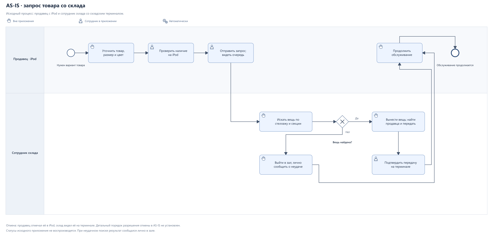
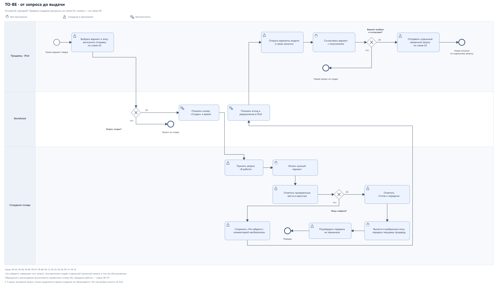
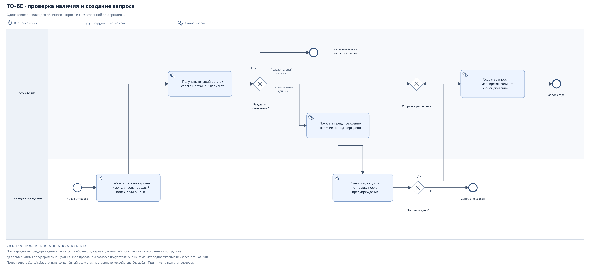
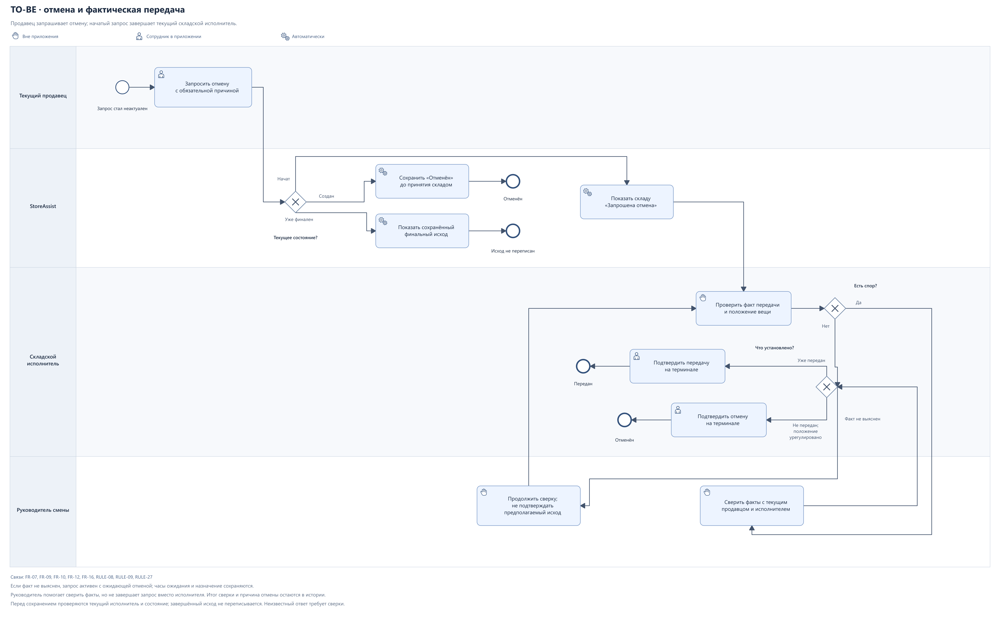
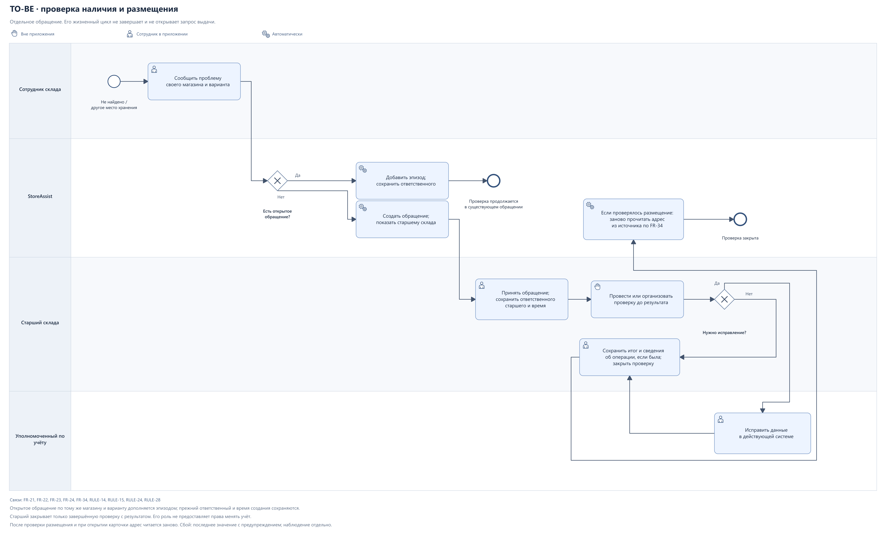
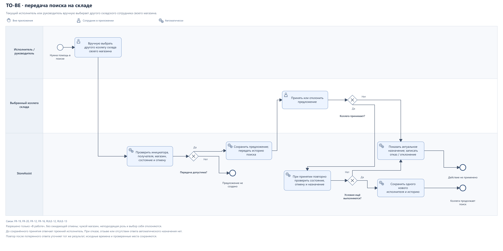
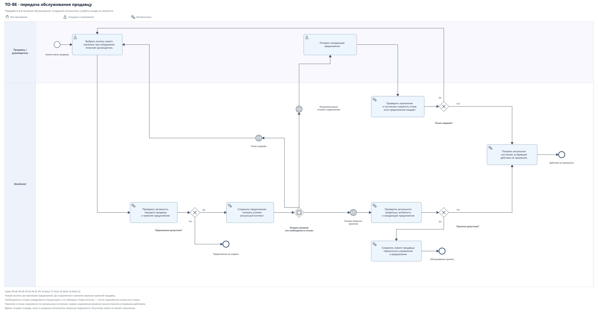

# Диаграммы StoreAssist

Схемы показывают исходную работу с запросом и проектный процесс TO-BE. Их можно читать по порядку: основной путь, правила создания, отмена, проверка расхождений и передачи работы.

| № | Диаграмма | Что показывает | Редактируемый исходник |
| --- | --- | --- | --- |
| 01 | [BPMN AS-IS](../assets/diagrams/01-bpmn-as-is.svg) | Проверка на iPod, поиск по стеллажу / секции, передача продавцу и личное сообщение при неудаче | [BPMN](../assets/diagrams/01-bpmn-as-is.bpmn) |
| 02 | [BPMN TO-BE: основной процесс](../assets/diagrams/02-bpmn-to-be.svg) | Создание запроса, поиск, готовность, выдача и переход к альтернативе | [BPMN](../assets/diagrams/02-bpmn-to-be.bpmn) |
| 03 | [Создание запроса](../assets/diagrams/03-bpmn-create-request.svg) | Обновление остатка, запрет при актуальном нуле и подтверждение неподтверждённого наличия | [BPMN](../assets/diagrams/03-bpmn-create-request.bpmn) |
| 04 | [Отмена и фактическая передача](../assets/diagrams/04-bpmn-cancellation.svg) | Отмена до / после принятия, спор при выносе и подтверждение фактического исхода | [BPMN](../assets/diagrams/04-bpmn-cancellation.bpmn) |
| 05 | [Проверка расхождения](../assets/diagrams/05-bpmn-discrepancy.svg) | Новый эпизод, ответственное лицо, проверка, учётное исправление и повторное чтение адреса | [BPMN](../assets/diagrams/05-bpmn-discrepancy.bpmn) |
| 06 | [Передача поиска](../assets/diagrams/06-bpmn-search-handover.svg) | Выбор складского коллеги, принятие и повторная проверка условий | [BPMN](../assets/diagrams/06-bpmn-search-handover.bpmn) |
| 07 | [Передача обслуживания](../assets/diagrams/07-bpmn-service-handover.svg) | Принятие новым продавцом, отказ, отзыв и повторный выбор коллеги | [BPMN](../assets/diagrams/07-bpmn-service-handover.bpmn) |
| 08 | [UML: состояния запроса](../assets/diagrams/08-request-states.svg) | Активные состояния, признак отмены и три финальных исхода | [PlantUML](../assets/diagrams/08-request-states.puml) |

## 01. AS-IS: запрос товара со склада

[SVG](../assets/diagrams/01-bpmn-as-is.svg) · [PNG](../assets/diagrams/01-bpmn-as-is.png) · [BPMN](../assets/diagrams/01-bpmn-as-is.bpmn)

Сотрудник склада находит продавца в торговом зале и передаёт ему вещь; передачу подтверждает через складской терминал. Если вещь не найдена, он сообщает об этом лично в зале. Отмена через iPod и её показ на терминале отмечены отдельно: неподтверждённый порядок разрешения отмены в исходном приложении не восстанавливается.

Названия и набор исторических статусов не воспроизводятся. Ветка «вещь найдена?» описывает результат поиска, а не статус приложения. Основание: [подтверждённые действия AS-IS](01-PROCESS-AS-IS-TO-BE.md).

## 02. TO-BE: основной процесс

[SVG](../assets/diagrams/02-bpmn-to-be.svg) · [PNG](../assets/diagrams/02-bpmn-to-be.png) · [BPMN](../assets/diagrams/02-bpmn-to-be.bpmn)

Основная схема рассматривает один запрос. Готовность не равна выдаче: «Передан» сохраняется только после подтверждения складом фактической передачи. «Не найдено» завершает исходный запрос; выбор альтернативы не открывает его заново. После согласования альтернативы выполняется новая попытка создания по схеме 03. Её результат может быть как успешным, так и запрещённым правилом наличия.

Похожие товары берутся только по готовым связям существующего каталога. Если связей нет, остаются размеры / цвета той же модели; недоступность источника отличается от отсутствия вариантов. Сам просмотр не создаёт запрос. Обращение о расхождении выполняется независимо по схеме 05 и не блокирует согласование альтернативы.

Отмена и передачи работы вынесены в схемы 04, 06 и 07. Пометка ожидания с 5 минут не завершает запрос и не меняет исполнителя.

Связи: [FR-02](02-REQUIREMENTS.md#fr-02), [FR-04](02-REQUIREMENTS.md#fr-04), [FR-06](02-REQUIREMENTS.md#fr-06)—[FR-08](02-REQUIREMENTS.md#fr-08), [FR-13](02-REQUIREMENTS.md#fr-13)—[FR-14](02-REQUIREMENTS.md#fr-14), [FR-25](02-REQUIREMENTS.md#fr-25)—[FR-26](02-REQUIREMENTS.md#fr-26), [FR-31](02-REQUIREMENTS.md#fr-31)—[FR-32](02-REQUIREMENTS.md#fr-32); [AC-01](04-METRICS-AND-ACCEPTANCE.md#ac-01)—[AC-06](04-METRICS-AND-ACCEPTANCE.md#ac-06), [AC-10](04-METRICS-AND-ACCEPTANCE.md#ac-10), [AC-29](04-METRICS-AND-ACCEPTANCE.md#ac-29)—[AC-30](04-METRICS-AND-ACCEPTANCE.md#ac-30), [AC-48](04-METRICS-AND-ACCEPTANCE.md#ac-48), [AC-59](04-METRICS-AND-ACCEPTANCE.md#ac-59)—[AC-61](04-METRICS-AND-ACCEPTANCE.md#ac-61).

## 03. Создание запроса и наличие

[SVG](../assets/diagrams/03-bpmn-create-request.svg) · [PNG](../assets/diagrams/03-bpmn-create-request.png) · [BPMN](../assets/diagrams/03-bpmn-create-request.bpmn)

Перед каждой новой намеренной отправкой остаток обновляется для своего магазина и точного варианта. Актуальный ноль запрещает создание. Неизвестные или устаревшие сведения, включая прежний ноль, требуют предупреждения и отдельного подтверждения текущего продавца. Это подтверждение продолжает ту же попытку: повторного обновления по кругу нет.

Для альтернативы предварительно нужны согласие покупателя и явный выбор продавца. Согласие покупателя не заменяет подтверждение продавца при неподтверждённом наличии. Сбой источника остатков не означает недоступность самого StoreAssist. При потерянном ответе на создание сначала выясняется сохранённый результат; повтор того же действия не создаёт дубль. Новое намеренное обращение за тем же вариантом остаётся отдельным запросом.

Связи: [FR-01](02-REQUIREMENTS.md#fr-01)—[FR-02](02-REQUIREMENTS.md#fr-02), [FR-11](02-REQUIREMENTS.md#fr-11), [FR-16](02-REQUIREMENTS.md#fr-16), [FR-18](02-REQUIREMENTS.md#fr-18), [FR-26](02-REQUIREMENTS.md#fr-26), [FR-31](02-REQUIREMENTS.md#fr-31)—[FR-32](02-REQUIREMENTS.md#fr-32); [AC-01](04-METRICS-AND-ACCEPTANCE.md#ac-01), [AC-09](04-METRICS-AND-ACCEPTANCE.md#ac-09), [AC-17](04-METRICS-AND-ACCEPTANCE.md#ac-17), [AC-44](04-METRICS-AND-ACCEPTANCE.md#ac-44)—[AC-47](04-METRICS-AND-ACCEPTANCE.md#ac-47), [AC-50](04-METRICS-AND-ACCEPTANCE.md#ac-50)—[AC-52](04-METRICS-AND-ACCEPTANCE.md#ac-52).

## 04. Отмена и фактический исход

[SVG](../assets/diagrams/04-bpmn-cancellation.svg) · [PNG](../assets/diagrams/04-bpmn-cancellation.png) · [BPMN](../assets/diagrams/04-bpmn-cancellation.bpmn)

Непринятый запрос продавец отменяет с обязательной причиной. После принятия запрос остаётся активным с признаком ожидающей отмены. Складской исполнитель урегулирует фактическое положение вещи и подтверждает отмену на терминале. Если нужный вариант уже передан, он подтверждает передачу.

При споре руководитель помогает сверить факты с текущим продавцом и исполнителем; самостоятельного права завершить запрос вместо склада у него нет. До выяснения запрос остаётся активным. Проверяются актуальное назначение и состояние; уже завершённый исход не переписывается. Причина отмены, участие руководителя и итог сверки сохраняются в истории.

Связи: [FR-07](02-REQUIREMENTS.md#fr-07), [FR-09](02-REQUIREMENTS.md#fr-09)—[FR-10](02-REQUIREMENTS.md#fr-10), [FR-12](02-REQUIREMENTS.md#fr-12), [FR-16](02-REQUIREMENTS.md#fr-16), [RULE-08](02-REQUIREMENTS.md#rule-08)—[RULE-09](02-REQUIREMENTS.md#rule-09), [RULE-27](02-REQUIREMENTS.md#rule-27); [AC-07](04-METRICS-AND-ACCEPTANCE.md#ac-07)—[AC-09](04-METRICS-AND-ACCEPTANCE.md#ac-09), [AC-62](04-METRICS-AND-ACCEPTANCE.md#ac-62)—[AC-65](04-METRICS-AND-ACCEPTANCE.md#ac-65).

## 05. Проверка расхождения и размещения

[SVG](../assets/diagrams/05-bpmn-discrepancy.svg) · [PNG](../assets/diagrams/05-bpmn-discrepancy.png) · [BPMN](../assets/diagrams/05-bpmn-discrepancy.bpmn)

Если открытое обращение того же магазина и варианта уже есть, добавляется эпизод: существующая проверка не запускается повторно, её ответственный и время создания сохраняются. После закрытия предыдущего обращения новая проблема создаёт новое связанное обращение.

Новую проверку принимает старший склада. Он доводит её до результата и закрывает; незавершённая проверка остаётся в работе. Учёт исправляет уполномоченный сотрудник в существующей системе. Старший может выполнить исправление сам только при наличии отдельного полномочия.

После проверки размещения и при следующем открытии карточки StoreAssist заново получает адрес из источника. При сбое остаётся последнее значение с временем и предупреждением; если значения нет — неизвестное размещение. Явное отсутствие адреса не считается сбоем. Прежний адрес в успешном ответе не подменяется наблюдением сотрудника.

Закрытие обращения не меняет финальный исход выдачи. Само чтение адреса и закрытие без подтверждённого снятия проблемы не прекращают двухчасовое предупреждение о прошлом «Не найдено».

Связи: [FR-21](02-REQUIREMENTS.md#fr-21)—[FR-24](02-REQUIREMENTS.md#fr-24), [FR-34](02-REQUIREMENTS.md#fr-34), [RULE-11](02-REQUIREMENTS.md#rule-11), [RULE-14](02-REQUIREMENTS.md#rule-14)—[RULE-15](02-REQUIREMENTS.md#rule-15), [RULE-24](02-REQUIREMENTS.md#rule-24), [RULE-28](02-REQUIREMENTS.md#rule-28); [AC-25](04-METRICS-AND-ACCEPTANCE.md#ac-25)—[AC-28](04-METRICS-AND-ACCEPTANCE.md#ac-28), [AC-49](04-METRICS-AND-ACCEPTANCE.md#ac-49), [AC-53](04-METRICS-AND-ACCEPTANCE.md#ac-53)—[AC-54](04-METRICS-AND-ACCEPTANCE.md#ac-54), [AC-66](04-METRICS-AND-ACCEPTANCE.md#ac-66)—[AC-69](04-METRICS-AND-ACCEPTANCE.md#ac-69).

## 06. Передача поиска на складе

[SVG](../assets/diagrams/06-bpmn-search-handover.svg) · [PNG](../assets/diagrams/06-bpmn-search-handover.png) · [BPMN](../assets/diagrams/06-bpmn-search-handover.bpmn)

Текущий исполнитель или руководитель вручную выбирает другого складского сотрудника своего магазина. Передача разрешена только из «В работе» и без ожидающей отмены. Получатель должен принять предложение; до сохранённого принятия отвечает прежний исполнитель. Отсутствие ответа не считается принятием.

При принятии условия проверяются снова: после сохранённой отмены передача недоступна, а если исполнитель уже сменился, отмену разрешает текущий. Неуспешная попытка не откатывает чужие сохранённые действия. Коллега получает проверенные места и историю, время создания запроса не сбрасывается.

Связи: [FR-19](02-REQUIREMENTS.md#fr-19)—[FR-20](02-REQUIREMENTS.md#fr-20), [FR-12](02-REQUIREMENTS.md#fr-12), [FR-16](02-REQUIREMENTS.md#fr-16), [RULE-12](02-REQUIREMENTS.md#rule-12)—[RULE-13](02-REQUIREMENTS.md#rule-13); [AC-21](04-METRICS-AND-ACCEPTANCE.md#ac-21)—[AC-24](04-METRICS-AND-ACCEPTANCE.md#ac-24), [AC-32](04-METRICS-AND-ACCEPTANCE.md#ac-32)—[AC-33](04-METRICS-AND-ACCEPTANCE.md#ac-33), [AC-55](04-METRICS-AND-ACCEPTANCE.md#ac-55).

## 07. Передача обслуживания продавцу

[SVG](../assets/diagrams/07-bpmn-service-handover.svg) · [PNG](../assets/diagrams/07-bpmn-service-handover.png) · [BPMN](../assets/diagrams/07-bpmn-service-handover.bpmn)

Перед перерывом, окончанием смены или в сложной ситуации продавец предлагает всё активное обслуживание коллеге своего магазина. Выбранный коллега сам принимает или отклоняет предложение. После принятия к нему переходят управление и новые уведомления; реальные авторы прежних действий сохраняются. Передача допустима при готовности и ожидающей складской отмене: ограничения передачи поиска к ней не относятся.

Если коллега отказался, продавец выбирает другого; при затруднении или отсутствии продавца помогает руководитель. Если ответа нет, сначала отзывается ожидающее предложение. Новое предложение возможно только после подтверждённого разрешения прежнего. Одновременно ожидает ответа одно предложение.

Ромб ожидания реагирует на одно из условий: коллега запросил принятие, сохранён отказ или инициатор решил отозвать предложение. Значок листа внутри двойного круга обозначает условное событие. Это внутренние условия процесса магазина, а не обмен сообщениями между отдельными участниками BPMN. Если ни одно условие не наступило, процесс остаётся в ожидании; автоматического назначения или отзыва по времени нет.

Необходимость отзыва определяет сам инициатор. Затем продавец или руководитель выполняет действие «Отозвать ожидающее предложение». Система проверяет актуальное назначение и состояние и сохраняет отзыв только для ещё ожидающего предложения. После сохранённого отзыва или отказа поток возвращается к единственному действию выбора коллеги. Если отзыв уже недопустим, система показывает актуальное состояние и не применяет устаревшее действие.

Принятие и отзыв проверяются по актуальному состоянию. Сохранённый первым отзыв запрещает позднее принятие старого предложения; сохранённое первым принятие не отменяется устаревшим отзывом. Время, очередь, зона и складские исполнители запросов сохраняются. Один завершённый запрос не завершает обслуживание автоматически.

Связи: [FR-28](02-REQUIREMENTS.md#fr-28)—[FR-30](02-REQUIREMENTS.md#fr-30), [FR-33](02-REQUIREMENTS.md#fr-33), [FR-16](02-REQUIREMENTS.md#fr-16), [RULE-17](02-REQUIREMENTS.md#rule-17)—[RULE-20](02-REQUIREMENTS.md#rule-20), [RULE-25](02-REQUIREMENTS.md#rule-25); [AC-34](04-METRICS-AND-ACCEPTANCE.md#ac-34)—[AC-43](04-METRICS-AND-ACCEPTANCE.md#ac-43), [AC-56](04-METRICS-AND-ACCEPTANCE.md#ac-56)—[AC-58](04-METRICS-AND-ACCEPTANCE.md#ac-58).

## 08. UML: состояния запроса

[SVG](../assets/diagrams/08-request-states.svg) · [PNG](../assets/diagrams/08-request-states.png) · [PlantUML](../assets/diagrams/08-request-states.puml)

«Создан», «В работе» и «Готов к передаче» — активные состояния. «Передан», «Не найдено» и «Отменён» — три финальных исхода. Запрошенная отмена — признак активного запроса, а не отдельный статус; её не следует смешивать с финальным «Отменён».

Ошибка готовности возвращает запрос в работу с причиной, сохраняя историю. Если уже ожидает отмена, исполнитель сначала разрешает её, а не продолжает ненужный поиск. Комментарий к «Не найдено» необязателен. Дополнительное подтверждение получения продавцом не требуется.

Для спорной отмены по [FR-10](02-REQUIREMENTS.md#fr-10) отдельно показан исключительный переход из «В работе» в «Передан»: он допустим только при ожидающей отмене и подтверждённой складом фактической передаче. Это фиксация установленного факта; пропуск готовности в обычной выдаче не разрешается.

Потеря связи, предупреждение о прошлом поиске, пятиминутная пометка, передача поиска и смена продавца не добавляют статусов запроса. Обращение на проверку и предложение передачи имеют собственные жизненные циклы, описанные в [решениях](05-DECISIONS-AND-QUESTIONS.md).

Связи: [FR-04](02-REQUIREMENTS.md#fr-04), [FR-06](02-REQUIREMENTS.md#fr-06)—[FR-10](02-REQUIREMENTS.md#fr-10), [FR-14](02-REQUIREMENTS.md#fr-14), [FR-16](02-REQUIREMENTS.md#fr-16)—[FR-17](02-REQUIREMENTS.md#fr-17), [FR-19](02-REQUIREMENTS.md#fr-19), [FR-28](02-REQUIREMENTS.md#fr-28)—[FR-30](02-REQUIREMENTS.md#fr-30), [RULE-06](02-REQUIREMENTS.md#rule-06)—[RULE-09](02-REQUIREMENTS.md#rule-09), [RULE-27](02-REQUIREMENTS.md#rule-27); [AC-02](04-METRICS-AND-ACCEPTANCE.md#ac-02), [AC-04](04-METRICS-AND-ACCEPTANCE.md#ac-04)—[AC-08](04-METRICS-AND-ACCEPTANCE.md#ac-08), [AC-10](04-METRICS-AND-ACCEPTANCE.md#ac-10), [AC-18](04-METRICS-AND-ACCEPTANCE.md#ac-18), [AC-48](04-METRICS-AND-ACCEPTANCE.md#ac-48), [AC-62](04-METRICS-AND-ACCEPTANCE.md#ac-62)—[AC-65](04-METRICS-AND-ACCEPTANCE.md#ac-65).
