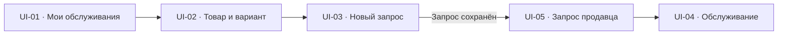
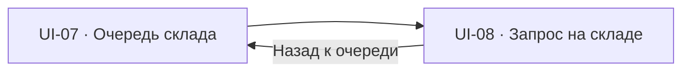

# Карта экранов и переходов StoreAssist

Карта связывает [сценарии TO-BE](07-USE-CASES.md) с экранами и состояниями TO-BE. Она определяет полный состав интерфейса TO-BE и переходы. По карте подготовлен [локальный интерактивный прототип](09-PROTOTYPE.md): основной путь, исключения, альтернативы, передачи, обращения и обзор смены. Источники и сбои моделируются; границы проверки указаны в описании прототипа.

Карта описывает целевой состав экранов. [Текущий статус макетов](09-PROTOTYPE.md) и [проверка](../prototype/QA.md) ведутся отдельно.

`UI` обозначает экран карты. Предупреждения, формы отдельных действий и состояния загрузки входят в экраны и не получают отдельные номера. Состояние интерфейса не всегда означает новое состояние запроса: например, потеря связи, пометка ожидания и предложение передачи его не меняют.

## 1. Рабочие места и границы

| Участник / система | Представление | Граница действий |
| --- | --- | --- |
| Продавец | iPod, последовательные экраны в одну колонку | Своё обслуживание; до принятия предложения коллеги — только контекст для решения |
| Сотрудник склада | Складской терминал: очередь и карточка запроса | Очередь своего магазина; выполнение и исходы по текущему назначению |
| Старший склада | Очередь обращений и карточка проверки | Новые обращения своего магазина и принятые им проверки; итог сохраняет ответственный старший |
| Руководитель смены | Обзор запросов и предложений передачи | Контроль смены, организация передач и помощь при споре; не подтверждает выдачу или отмену вместо исполнителя |
| Покупатель | Отдельного интерфейса нет | Согласует вариант или отказ через продавца |
| StoreAssist | Действия системы на каждом экране | Сохраняет запросы, назначения и историю, показывает события и проверяет права |
| Существующие источники | Данные внутри экранов StoreAssist | Каталог, остатки и размещение поступают из источников. Учётное исправление выполняется в действующей системе вне прототипа |

Для старшего склада и руководителя на этапе макетов используются отдельные рабочие представления. Конкретное устройство для них не задаётся. Каталог, остатки и размещение могут находиться в одной системе; карта не определяет архитектуру интеграции. [Роли и границы](03-STAKEHOLDERS-AND-SCOPE.md).

## 2. Реестр экранов

### iPod продавца

| ID | Экран | Основные данные | Доступные действия |
| --- | --- | --- | --- |
| UI-01 | Мои обслуживания | Общие номера, активные обслуживания текущего продавца, поступившие ему предложения передачи | Открыть своё обслуживание; начать первый запрос; открыть контекст предложения и принять / отклонить его |
| UI-02 | Товар и вариант | Модель, размер, цвет, сведения о наличии и доступное время обновления | Выбрать точный вариант и перейти к подготовке запроса; просмотреть предупреждение о прошлом поиске |
| UI-03 | Новый запрос | Точный вариант, одна единица, магазин, место передачи; для альтернативы — исходный запрос и обслуживание | Проверить данные и отправить; при неподтверждённом наличии отдельно подтвердить предупреждение или отказаться |
| UI-04 | Обслуживание | Общий номер без данных покупателя, текущий продавец, все связанные запросы, альтернативы, непросмотренные результаты и предложение передачи | Открыть запрос; подготовить следующий запрос в том же обслуживании; предложить передачу; завершить обслуживание при выполнении условий |
| UI-05 | Запрос продавца | Номер, вариант, состояние, возраст, место, текущий складской исполнитель, ожидающая отмена, история и связи | Отменить непринятый запрос или запросить отмену начатого; из «Не найдено» открыть альтернативы; просмотреть результат проверки и историю |
| UI-06 | Альтернативы | Варианты модели, похожие товары по готовым связям, состояние наличия своего магазина; отдельно — сбой источника и пустой результат | Выбрать точный вариант после согласия покупателя и перейти в [UI-03](#ui-03); вернуться без нового запроса |

### Терминал склада

| ID | Экран | Основные данные | Доступные действия |
| --- | --- | --- | --- |
| UI-07 | Очередь склада | Запросы своего магазина, состояние, возраст, исполнитель, стеллаж / секция либо отсутствие адреса; ожидающие принятия — от старых к новым | Открыть запрос; увидеть адресованные сотруднику предложения передачи поиска |
| UI-08 | Запрос на складе | Точный вариант, адрес источника, время получения и доступное время обновления, наблюдения отдельно, проверенные места, текущий продавец, место передачи, история и отмена | Принять; отметить готовность; подтвердить фактическую передачу; сохранить «Не найдено»; разрешить отмену; вернуть ошибочную готовность в работу; предложить / принять передачу поиска; сообщить расхождение |

### Старший склада и руководитель

| ID | Экран | Основные данные | Доступные действия |
| --- | --- | --- | --- |
| UI-09 | Обращения на проверку | Новые обращения своего магазина и проверки, принятые текущим старшим; вариант, тип проблемы, возраст и ответственный | Открыть обращение; принять новое в работу |
| UI-10 | Карточка проверки | Связанные эпизоды, исходный и фактический адрес, текущий ответ источника с временем, ответственный, наблюдения, результат, время и сведения об учётной операции, если она выполнена | Ответственному старшему — сохранить результат и пояснение, закрыть завершённую проверку; просмотреть заново полученный адрес отдельно от наблюдений |
| UI-11 | Обзор смены | Запросы, возраст, состояния и ответственные; пометки ожидания, предложения передачи и сведения об открытых обращениях | Открыть контекст; предложить передачу поиска или обслуживания; отозвать ожидающее предложение обслуживания перед повторной попыткой; помочь сверить факты спорной отмены |

У [UI-08](#ui-08) и [UI-10](#ui-10) набор доступных действий определяется ролью и текущим назначением, а не только названием экрана. Просмотр контекста руководителем не даёт полномочий складского исполнителя или ответственного старшего. Отсутствующий доступ нельзя получить переходом по прямой ссылке: [FR-15](02-REQUIREMENTS.md#fr-15).

## 3. Основные пути

### Запрос со стороны продавца

### Работа склада

Эти схемы показывают навигацию, а не все развилки процесса. Сохранение действия на терминале обновляет состояние, видимое продавцу; оно не переводит пользователя между рабочими местами. Полные правила действий остаются в сценариях и BPMN.

### Переходы и условия

| Откуда | Действие / событие | Куда / что изменяется |
| --- | --- | --- |
| [UI-01](#ui-01) | Открыть своё обслуживание | [UI-04](#ui-04) с выбранным общим номером |
| [UI-01](#ui-01) | Начать первый запрос | [UI-02](#ui-02); обслуживание создаётся только после сохранённого первого запроса |
| [UI-04](#ui-04) | Подготовить следующий запрос | [UI-02](#ui-02) → [UI-03](#ui-03) с сохранением контекста активного обслуживания |
| [UI-02](#ui-02) | Выбрать точный вариант | [UI-03](#ui-03) с товаром, размером и цветом |
| [UI-03](#ui-03) | Отправить; система сохранила запрос | [UI-05](#ui-05) с номером и временем; первый запрос создаёт обслуживание, связанный — входит в текущее |
| [UI-03](#ui-03) | Актуальный ноль, отказ от предупреждения или неподтверждённое сохранение | Остаётся [UI-03](#ui-03) с соответствующим объяснением; успешный переход не имитируется |
| [UI-05](#ui-05) | Вернуться к обслуживанию | [UI-04](#ui-04); открытие или закрытие карточки не меняет состояния запроса |
| [UI-05](#ui-05) | Открыть альтернативы из «Не найдено» | [UI-06](#ui-06); исходный запрос остаётся финальным |
| [UI-06](#ui-06) | Согласовать и выбрать вариант | [UI-03](#ui-03) с новым вариантом и ссылкой на исходный запрос; отправка проходит новое обновление остатка |
| [UI-06](#ui-06) | Отказаться или вернуться | [UI-05](#ui-05); нового запроса нет |
| [UI-07](#ui-07) | Открыть запрос | [UI-08](#ui-08); при открытии карточки заново читается размещение |
| [UI-08](#ui-08) | Принять, отметить готовность или сохранить исход | Остаётся [UI-08](#ui-08) с подтверждённым состоянием; [UI-05](#ui-05) показывает результат текущему продавцу |
| [UI-08](#ui-08) | Сообщить «Не найдено» или другое место хранения и инициировать обращение | Остаётся [UI-08](#ui-08) со связью на обращение; новое появляется в [UI-09](#ui-09) либо эпизод дополняет открытое |
| [UI-09](#ui-09) | Открыть обращение | [UI-10](#ui-10); просмотр сам по себе не назначает ответственного. При открытии карточки с размещением адрес заново читается из источника |
| [UI-10](#ui-10) | Принять новое обращение | Остаётся [UI-10](#ui-10); после сохранения видны ответственный старший и время |
| [UI-10](#ui-10) | Закрыть завершённую проверку с результатом | Остаётся [UI-10](#ui-10) с итогом; после проверки размещения заново читается адрес. Запрос выдачи не открывается заново |
| [UI-01](#ui-01) / [UI-04](#ui-04) | Принять адресованное предложение обслуживания | [UI-04](#ui-04) с актуальным контекстом после сохранённой смены продавца |
| [UI-07](#ui-07) / [UI-08](#ui-08) | Принять адресованное предложение поиска | [UI-08](#ui-08) с новым складским исполнителем после повторной проверки условий |
| [UI-11](#ui-11) | Открыть запрос, обслуживание или сведения об обращении | Соответствующая карточка в пределах роли руководителя; действия исполнителя / старшего не появляются |
| [UI-04](#ui-04) | Завершить обслуживание | [UI-01](#ui-01) после сохранения; при активных запросах или ожидающих предложениях остаётся [UI-04](#ui-04) с объяснением |

Отмена подготовки до отправки возвращает в предыдущий экран без запроса. После неопределённой отправки сначала устанавливается сохранённый результат по [UC-10](07-USE-CASES.md#uc-10). Повторное намеренное создание не используется вместо этой сверки.

## 4. Панели действий внутри экранов

| Панель | Где и для кого | Данные и результат |
| --- | --- | --- |
| Неподтверждённое наличие | [UI-03](#ui-03), текущий продавец | Вариант, последнее значение и время, если доступны, причина неподтверждённости. Отдельное подтверждение относится к текущей отправке; актуальный ноль подтвердить в обход запрета нельзя |
| Прошлый безрезультатный поиск | [UI-02](#ui-02) / [UI-03](#ui-03) до создания, [UI-08](#ui-08) при принятии | Время исхода, проверенное место и результат проверки своего магазина и точного варианта. Сводка не открывает чужое обслуживание и сама не блокирует запрос |
| Отмена запроса | [UI-05](#ui-05), текущий продавец | Обязательная причина. «Создан» отменяется сразу после сохранения; начатая работа получает признак ожидающей отмены |
| Разрешение отмены | [UI-08](#ui-08), текущий складской исполнитель | Причина отмены и фактическое положение вещи; при споре — участие руководителя и итог сверки. Исполнитель фиксирует передачу или урегулированную отмену; до выяснения запрос активен |
| «Не найдено» | [UI-08](#ui-08), текущий исполнитель | Свободный необязательный комментарий; выбора обязательной причины нет. После сохранения — финальный исход и уведомление продавцу |
| Возврат ошибочной готовности | [UI-08](#ui-08), текущий исполнитель | Обязательная причина возврата в работу. История готовности и ожидающая отмена сохраняются; при ожидающей отмене сначала разрешается она |
| Передача поиска | [UI-08](#ui-08); руководитель инициирует из [UI-11](#ui-11) | Выбор другого сотрудника со складским полномочием своего магазина, проверенные места и пояснение. Получатель просматривает контекст и принимает / отклоняет. До принятия отвечает прежний исполнитель |
| Передача обслуживания | [UI-04](#ui-04); руководитель инициирует из [UI-11](#ui-11); получатель открывает из [UI-01](#ui-01) | Выбор коллеги своего магазина, всё обслуживание и актуальные результаты. Получатель принимает / отклоняет; инициатор отзывает ожидающее предложение перед повторной попыткой. До принятия отвечает прежний продавец |
| Сообщение о расхождении | [UI-08](#ui-08), сотрудник с правом сообщить эпизод; в том числе после «Не найдено» | Тип проблемы, вариант; для размещения — исходный и фактический адрес с пояснением. Сохранение создаёт обращение либо добавляет эпизод; источник автоматически не исправляется |
| Результат проверки | [UI-10](#ui-10), ответственный старший | Результат и пояснение, сведения о фактически выполненной учётной операции. Незаконченную проверку закрыть нельзя; учётная операция остаётся вне StoreAssist |
| История | [UI-04](#ui-04) / [UI-05](#ui-05) / [UI-08](#ui-08) / [UI-10](#ui-10) в пределах доступа | События, реальные авторы и время, причины и комментарии, связанные запросы, предложения и обращения. Просмотр не меняет назначение и финальные исходы |

Панель передачи поиска и панель передачи обслуживания имеют разные условия доступности. Первую нельзя применить при готовности, финальном исходе или ожидающей отмене запроса; вторую можно использовать при готовом запросе и ожидающей складской отмене, пока обслуживание активно: [RULE-12](02-REQUIREMENTS.md#rule-12), [RULE-17](02-REQUIREMENTS.md#rule-17)—[RULE-20](02-REQUIREMENTS.md#rule-20).

## 5. Состояния для макетов и демонстрации

| Группа | Где показать | Обязательные варианты | Критерии |
| --- | --- | --- | --- |
| Создание и наличие | [UI-02](#ui-02) / [UI-03](#ui-03) | Точный вариант выбран / не выбран; новый положительный остаток / актуальный ноль; неизвестность, устаревшее значение и сбой обновления; отдельное подтверждение текущей отправки / отказ | [AC-01](04-METRICS-AND-ACCEPTANCE.md#ac-01), [AC-17](04-METRICS-AND-ACCEPTANCE.md#ac-17), [AC-44](04-METRICS-AND-ACCEPTANCE.md#ac-44)—[AC-47](04-METRICS-AND-ACCEPTANCE.md#ac-47), [AC-50](04-METRICS-AND-ACCEPTANCE.md#ac-50)—[AC-51](04-METRICS-AND-ACCEPTANCE.md#ac-51) |
| Очередь и принятие | [UI-07](#ui-07) / [UI-08](#ui-08) | Очередь от старых к новым; единственный исполнитель; второй сотрудник получает актуальное назначение | [AC-02](04-METRICS-AND-ACCEPTANCE.md#ac-02)—[AC-03](04-METRICS-AND-ACCEPTANCE.md#ac-03), [AC-15](04-METRICS-AND-ACCEPTANCE.md#ac-15) |
| Готовность и выдача | [UI-05](#ui-05) / [UI-08](#ui-08) | «В работе», «Готов к передаче», «Передан»; другой вариант не завершает исходный; ошибочная готовность возвращается с причиной; прочтение уведомления не подтверждает выдачу | [AC-04](04-METRICS-AND-ACCEPTANCE.md#ac-04)—[AC-05](04-METRICS-AND-ACCEPTANCE.md#ac-05), [AC-11](04-METRICS-AND-ACCEPTANCE.md#ac-11), [AC-13](04-METRICS-AND-ACCEPTANCE.md#ac-13)—[AC-14](04-METRICS-AND-ACCEPTANCE.md#ac-14), [AC-18](04-METRICS-AND-ACCEPTANCE.md#ac-18) |
| «Не найдено» и предупреждение | [UI-02](#ui-02) / [UI-03](#ui-03) / [UI-05](#ui-05) / [UI-08](#ui-08) | Пустой и заполненный комментарий; предупреждение до 2 часов, ровно через 2 часа и после подтверждённого снятия; чтение учётного остатка его не снимает; просмотр не продлевает окно | [AC-06](04-METRICS-AND-ACCEPTANCE.md#ac-06), [AC-19](04-METRICS-AND-ACCEPTANCE.md#ac-19)—[AC-20](04-METRICS-AND-ACCEPTANCE.md#ac-20), [AC-31](04-METRICS-AND-ACCEPTANCE.md#ac-31), [AC-49](04-METRICS-AND-ACCEPTANCE.md#ac-49), [AC-52](04-METRICS-AND-ACCEPTANCE.md#ac-52) |
| Отмена и спор | [UI-05](#ui-05) / [UI-08](#ui-08) / [UI-11](#ui-11) | До принятия; начатая работа с ожидающей отменой; подтверждённая отмена / фактическая передача; факт не выяснен; состояние изменилось во время сверки | [AC-07](04-METRICS-AND-ACCEPTANCE.md#ac-07)—[AC-08](04-METRICS-AND-ACCEPTANCE.md#ac-08), [AC-62](04-METRICS-AND-ACCEPTANCE.md#ac-62)—[AC-65](04-METRICS-AND-ACCEPTANCE.md#ac-65) |
| История и доступ | Все карточки | Сохранены авторы и времена; чужой магазин недоступен; сводка поиска не открывает чужое обслуживание | [AC-12](04-METRICS-AND-ACCEPTANCE.md#ac-12), [AC-16](04-METRICS-AND-ACCEPTANCE.md#ac-16), [AC-31](04-METRICS-AND-ACCEPTANCE.md#ac-31) |
| Контроль ожидания | [UI-04](#ui-04) / [UI-05](#ui-05) / [UI-11](#ui-11) | 4 мин 59 с / 5 минут; все активные состояния, в том числе с ожидающей отменой; после финала активной пометки нет; передачи возраст не сбрасывают | [AC-10](04-METRICS-AND-ACCEPTANCE.md#ac-10), [AC-48](04-METRICS-AND-ACCEPTANCE.md#ac-48) |
| Альтернативы | [UI-06](#ui-06) / [UI-03](#ui-03) | Связи каталога есть / отсутствуют / недоступны; карточка модели доступна / недоступна; нет подходящего варианта; согласие / отказ; новый запрос в том же обслуживании | [AC-29](04-METRICS-AND-ACCEPTANCE.md#ac-29)—[AC-30](04-METRICS-AND-ACCEPTANCE.md#ac-30), [AC-34](04-METRICS-AND-ACCEPTANCE.md#ac-34), [AC-59](04-METRICS-AND-ACCEPTANCE.md#ac-59)—[AC-61](04-METRICS-AND-ACCEPTANCE.md#ac-61) |
| Обращение и адрес | [UI-08](#ui-08) / [UI-09](#ui-09) / [UI-10](#ui-10) | Новое / принятое / закрытое обращение; повторный эпизод; недостаточно полномочий или результата; источник вернул старый / исправленный адрес, отсутствие адреса или сбой с последним значением / без него | [AC-25](04-METRICS-AND-ACCEPTANCE.md#ac-25)—[AC-28](04-METRICS-AND-ACCEPTANCE.md#ac-28), [AC-53](04-METRICS-AND-ACCEPTANCE.md#ac-53)—[AC-54](04-METRICS-AND-ACCEPTANCE.md#ac-54), [AC-66](04-METRICS-AND-ACCEPTANCE.md#ac-66)—[AC-69](04-METRICS-AND-ACCEPTANCE.md#ac-69) |
| Передача поиска | [UI-07](#ui-07) / [UI-08](#ui-08) / [UI-11](#ui-11) | Ручной выбор допустимого коллеги; отказ / отсутствие ответа / принятие; недопустимая роль, магазин, состояние или получатель; сохранённая раньше отмена; первоначальный возраст и проверенные места сохранены | [AC-21](04-METRICS-AND-ACCEPTANCE.md#ac-21)—[AC-24](04-METRICS-AND-ACCEPTANCE.md#ac-24), [AC-33](04-METRICS-AND-ACCEPTANCE.md#ac-33), [AC-55](04-METRICS-AND-ACCEPTANCE.md#ac-55) |
| Передача обслуживания | [UI-01](#ui-01) / [UI-04](#ui-04) / [UI-11](#ui-11) | Только просмотр до принятия; один новый продавец после принятия; отказ, отсутствие ответа, отзыв и повторный выбор; помощь руководителя; принятие одновременно с отзывом или действием прежнего продавца; контекст обновлён | [AC-35](04-METRICS-AND-ACCEPTANCE.md#ac-35)—[AC-41](04-METRICS-AND-ACCEPTANCE.md#ac-41), [AC-43](04-METRICS-AND-ACCEPTANCE.md#ac-43), [AC-56](04-METRICS-AND-ACCEPTANCE.md#ac-56)—[AC-58](04-METRICS-AND-ACCEPTANCE.md#ac-58) |
| Завершение обслуживания | [UI-04](#ui-04) / [UI-01](#ui-01) | Все запросы финальны и предложения разрешены; запрет при открытых запросах или ожидающем предложении; завершённое обслуживание не передаётся | [AC-42](04-METRICS-AND-ACCEPTANCE.md#ac-42) |
| Неопределённый результат | Экран исходного действия | Действие отправлено, но результат не установлен; после сверки показан сохранённый результат и актуальный ответственный; повтор не создаёт второй запрос, исход или переход ответственности | [AC-09](04-METRICS-AND-ACCEPTANCE.md#ac-09), [AC-32](04-METRICS-AND-ACCEPTANCE.md#ac-32), [AC-41](04-METRICS-AND-ACCEPTANCE.md#ac-41), [AC-51](04-METRICS-AND-ACCEPTANCE.md#ac-51), [AC-56](04-METRICS-AND-ACCEPTANCE.md#ac-56), [AC-58](04-METRICS-AND-ACCEPTANCE.md#ac-58), [AC-65](04-METRICS-AND-ACCEPTANCE.md#ac-65) |

Для списков нужны также загрузка, пустое состояние и ошибка получения данных. Пустая очередь означает отсутствие доступных записей, а ошибка — невозможность их получить; одно не подменяет другое. Неопределённый результат изменяющего действия показывается отдельно от ошибки чтения. При окончании срока предупреждения исчезает только предупреждение, а история поиска остаётся.

## 6. Связи экранов со сценариями и требованиями

| Экран / группа | Сценарии | Требования |
| --- | --- | --- |
| [UI-01](#ui-01) / [UI-04](#ui-04) | [UC-01](07-USE-CASES.md#uc-01), [UC-08](07-USE-CASES.md#uc-08), [UC-09](07-USE-CASES.md#uc-09) | [FR-05](02-REQUIREMENTS.md#fr-05), [FR-12](02-REQUIREMENTS.md#fr-12)—[FR-15](02-REQUIREMENTS.md#fr-15), [FR-27](02-REQUIREMENTS.md#fr-27)—[FR-30](02-REQUIREMENTS.md#fr-30), [FR-33](02-REQUIREMENTS.md#fr-33) |
| [UI-02](#ui-02) / [UI-03](#ui-03) | [UC-01](07-USE-CASES.md#uc-01), [UC-03](07-USE-CASES.md#uc-03), [UC-05](07-USE-CASES.md#uc-05) | [FR-01](02-REQUIREMENTS.md#fr-01)—[FR-02](02-REQUIREMENTS.md#fr-02), [FR-18](02-REQUIREMENTS.md#fr-18), [FR-26](02-REQUIREMENTS.md#fr-26)—[FR-27](02-REQUIREMENTS.md#fr-27), [FR-31](02-REQUIREMENTS.md#fr-31)—[FR-32](02-REQUIREMENTS.md#fr-32) |
| [UI-05](#ui-05) | [UC-02](07-USE-CASES.md#uc-02)—[UC-05](07-USE-CASES.md#uc-05), [UC-09](07-USE-CASES.md#uc-09) | [FR-05](02-REQUIREMENTS.md#fr-05), [FR-07](02-REQUIREMENTS.md#fr-07)—[FR-09](02-REQUIREMENTS.md#fr-09), [FR-12](02-REQUIREMENTS.md#fr-12)—[FR-14](02-REQUIREMENTS.md#fr-14), [FR-24](02-REQUIREMENTS.md#fr-24), [FR-26](02-REQUIREMENTS.md#fr-26) |
| [UI-06](#ui-06) | [UC-05](07-USE-CASES.md#uc-05) | [FR-01](02-REQUIREMENTS.md#fr-01), [FR-25](02-REQUIREMENTS.md#fr-25)—[FR-26](02-REQUIREMENTS.md#fr-26), [FR-31](02-REQUIREMENTS.md#fr-31)—[FR-32](02-REQUIREMENTS.md#fr-32) |
| [UI-07](#ui-07) / [UI-08](#ui-08) | [UC-02](07-USE-CASES.md#uc-02)—[UC-04](07-USE-CASES.md#uc-04), [UC-06](07-USE-CASES.md#uc-06)—[UC-07](07-USE-CASES.md#uc-07) | [FR-03](02-REQUIREMENTS.md#fr-03)—[FR-04](02-REQUIREMENTS.md#fr-04), [FR-06](02-REQUIREMENTS.md#fr-06)—[FR-08](02-REQUIREMENTS.md#fr-08), [FR-10](02-REQUIREMENTS.md#fr-10), [FR-12](02-REQUIREMENTS.md#fr-12), [FR-17](02-REQUIREMENTS.md#fr-17)—[FR-21](02-REQUIREMENTS.md#fr-21), [FR-23](02-REQUIREMENTS.md#fr-23), [FR-34](02-REQUIREMENTS.md#fr-34) |
| [UI-09](#ui-09) / [UI-10](#ui-10) | [UC-06](07-USE-CASES.md#uc-06) | [FR-15](02-REQUIREMENTS.md#fr-15), [FR-21](02-REQUIREMENTS.md#fr-21)—[FR-24](02-REQUIREMENTS.md#fr-24), [FR-34](02-REQUIREMENTS.md#fr-34) |
| [UI-11](#ui-11) | [UC-04](07-USE-CASES.md#uc-04), [UC-07](07-USE-CASES.md#uc-07)—[UC-08](07-USE-CASES.md#uc-08) | [FR-10](02-REQUIREMENTS.md#fr-10), [FR-14](02-REQUIREMENTS.md#fr-14)—[FR-15](02-REQUIREMENTS.md#fr-15), [FR-19](02-REQUIREMENTS.md#fr-19), [FR-28](02-REQUIREMENTS.md#fr-28)—[FR-30](02-REQUIREMENTS.md#fr-30), [FR-33](02-REQUIREMENTS.md#fr-33) |
| Все изменяющие действия и их результаты | [UC-10](07-USE-CASES.md#uc-10) | [FR-11](02-REQUIREMENTS.md#fr-11), [FR-15](02-REQUIREMENTS.md#fr-15)—[FR-16](02-REQUIREMENTS.md#fr-16) |

Связи указывают, где показывается требование, и не заменяют его исходную формулировку. Наличие состояния в карте не означает, что прототип или интеграция уже прошли приёмку.

## 7. Текущий статус макетов

Все 11 экранов представлены в локальном прототипе; полнота отдельных состояний различается.

| Область | Статус |
| --- | --- |
| Основной путь | Доступны создание, принятие, готовность, передача и завершение обслуживания |
| Дополнительные ветки | Доступны отмена, ненахождение, альтернативы, передачи работы, обращения и обзор руководителя |
| Дополненные ветки | Доступны результаты / прочтение, сводки прошлых проверок, история проверенных мест, размещение в очереди и обзор ожидающих передач |
| Оставшаяся проверка | Текущая раскладка в браузере / на телефоне; серверная авторизация, реальные источники и конкурентность находятся вне локального макета |

[Маршрут демонстрации](09-PROTOTYPE.md) · [Статус и ограничения проверки](../prototype/QA.md).
