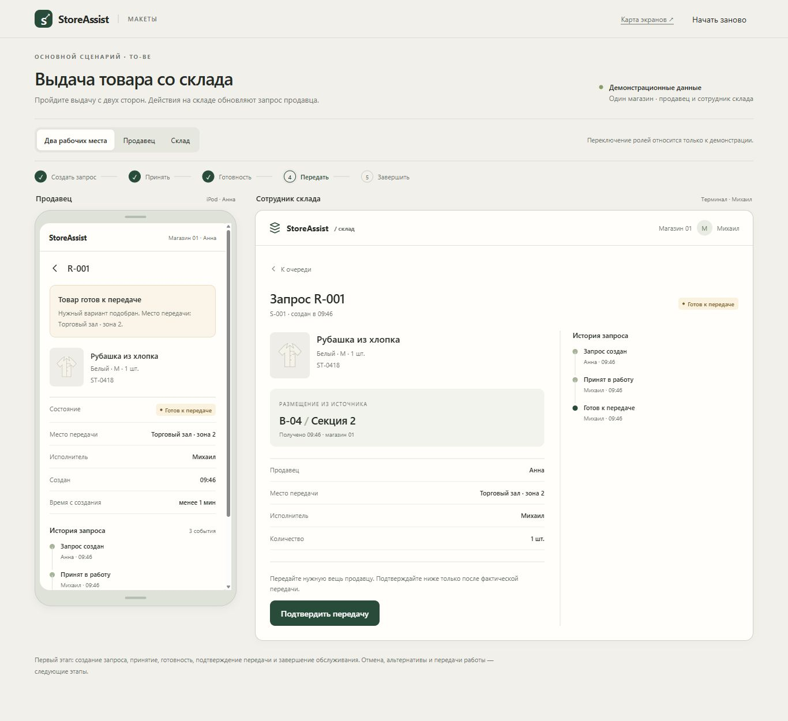

# Прототип StoreAssist

[Локальные макеты](../prototype/dist/index.html) · [Как запустить](../prototype/README.md) · [Карта экранов](08-SCREEN-MAP.md) · [Статус проверки](../prototype/QA.md)

Прототип показывает взаимодействие продавца с iPod и склада на терминале. Рабочие места используют один локальный набор данных; участники, товары и операции вымышлены. Переключение ролей и условий источников находится вне интерфейса продукта, в управлении демонстрацией.

## Основной маршрут

1. Продавец находит товар, выбирает точный размер / цвет и место передачи.
2. Отправляет запрос. Перед отправкой обновляется демонстрационное наличие: актуальный ноль запрещает запрос, неподтверждённое наличие требует отдельного подтверждения.
3. Сотрудник склада принимает запрос и отмечает готовность после подбора вещи.
4. После фактической передачи подтверждает её на терминале; продавец видит итог.
5. Продавец завершает обслуживание после финальных исходов всех запросов и разрешения предложений передачи.

[Подробный сценарий](07-USE-CASES.md#uc-02) · [Критерии основного запроса](04-METRICS-AND-ACCEPTANCE.md#ac-01).

## Дополнительные сценарии

| Что можно пройти | Где описано поведение |
| --- | --- |
| Ненахождение и предупреждение о предыдущем поиске | [UC-03](07-USE-CASES.md#uc-03) |
| Отмена до / после принятия и сверка фактического исхода | [UC-04](07-USE-CASES.md#uc-04) |
| Альтернатива после согласия покупателя — новый связанный запрос | [UC-05](07-USE-CASES.md#uc-05) |
| Обращение, принятие и результат проверки старшего | [UC-06](07-USE-CASES.md#uc-06) |
| Передача поиска и обслуживания: предложение, принятие, отказ и отзыв | [UC-07](07-USE-CASES.md#uc-07) · [UC-08](07-USE-CASES.md#uc-08) |
| Возврат ошибочной готовности в работу с причиной | [UC-02](07-USE-CASES.md#uc-02) |
| Потеря ответа, уточнение результата и явный повтор исходного действия | [UC-10](07-USE-CASES.md#uc-10) |

Руководитель открывает обзор активных запросов и организует передачу работы. Старший принимает собственную проверку и сохраняет её результат. Дополнительные операции открываются отдельными формами; черновики сохраняются в памяти вкладки при возврате.

## Границы демонстрации

Каталог, остатки, размещение и сбои моделируются локально. Реальных интеграций, серверной авторизации, резерва и изменения учёта нет. Передача обслуживания и поиск на складе остаются разными назначениями; старший не получает право учётных исправлений только за счёт своей роли.

Добавлены сводки непросмотренных результатов / прошлых проверок, история проверенных мест, размещение в очереди и полный обзор ожидающих передач руководителя. Локальная проверка и границы серверных испытаний описаны в [QA](../prototype/QA.md) и [карте критериев](10-PROTOTYPE-ACCEPTANCE.md).

## Проверка

Основной путь ранее был пройден в браузере в исходном оформлении. Текущая логика проверяется автоматическими тестами; раскладку новых экранов, прокрутку, фокус и клавиатуру телефона ещё нужно проверить на устройствах. Подробные результаты ведутся в [QA](../prototype/QA.md).

Изображение ниже показывает первоначальное оформление основного пути.

